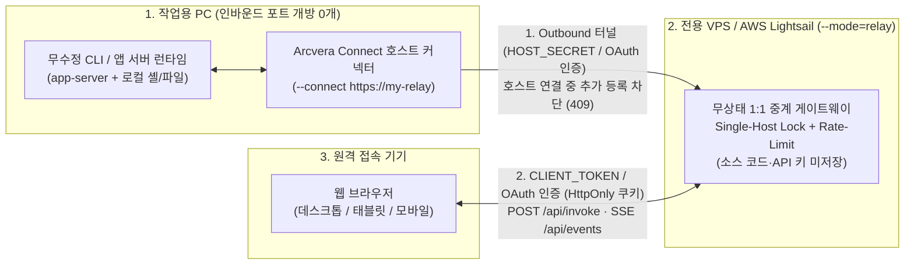

# Arcvera Connect (`opendiy-remote` `v1.2.3`)

**언어:** **[English (README.md)](./README.md)** | **한국어 ([README.ko.md](./README.ko.md))**

Arcvera Connect(`opendiy-remote`)는 데스크톱·태블릿·모바일 웹 브라우저에서 작업용 PC의 로컬 CLI 및 앱 서버 에이전트 세션을 안전하게 원격 제어하기 위한 **보안 우선 1:1 셀프호스팅(Self-hosted) 웹 원격 작업 공간**입니다.

---

## 목차

1. [개요 및 핵심 기능](#개요-및-핵심-기능)
2. [아키텍처 개요](#아키텍처-개요)
3. [시스템 요구 사항 및 호환성](#시스템-요구-사항-및-호환성)
4. [빠른 시작 및 배포 방법](#빠른-시작-및-배포-방법)
5. [CLI 옵션 및 환경 변수](#cli-옵션-및-환경-변수)
6. [보안 모델](#보안-모델)
7. [저장소 구조](#저장소-구조)
8. [검증 및 시험 명령](#검증-및-시험-명령)
9. [라이선스](#라이선스)

---

## 개요 및 핵심 기능

- **벤더 비종속 어댑터 경계 및 원본 무수정 연동**: 특정 벤더나 모델 식별자를 하드코딩하지 않고 런타임이 보고하는 모델·역량 메타데이터를 사용하며, 작업용 PC에 설치된 무수정 CLI 및 표준 JSON-RPC 2.0 앱 서버(`codex` / `opendiy-codex-launcher.exe` 등)와 직접 연동합니다.
- **1인 1중계기(1:1 Relay) 보안 아키텍처**: 전용 VPS(AWS Lightsail 등)에는 정적 웹 UI와 무상태 중계기(`--mode=relay`)만 배치하고 작업용 PC에서 역방향 아웃바운드 연결(`--connect`)을 수립하여 **작업용 PC 인바운드 포트 개방 0개**, **단일 호스트 독점 잠금(Single-Host Lock)**, **호스트·브라우저 비밀키 분리 및 반복 인증 실패 차단**을 보장합니다.
- **통합 웹 작업 공간 UI**: 프로젝트별 세션 분류, 크기 조절 가능한 다중 터미널(`xterm.js`)·구조화 대화 그리드, 질문·승인함(Question Inbox), 예약 작업(Cron), 확장 기능 및 서브에이전트 관리 기능을 브라우저에서 동일하게 제공합니다.

---

## 아키텍처 개요

### 1. 1:1 셀프호스팅 중계 모드 (외부 원격 접속 권장)



- **중계 서버(VPS / AWS Lightsail 등)**: 에이전트 CLI 실행 파일이나 프로젝트 소스를 설치할 필요가 없으며, 빌드된 `dist/`, `server/remote-server.mjs`, `package.json`만 배치하여 `--mode=relay`로 가동합니다.
- **작업용 PC**: 에이전트 CLI와 소스 저장소가 위치한 PC에서 `node server/remote-server.mjs --connect <중계서버주소>`를 실행하면 공유기 포트포워딩 없이 역방향 연결로 원격 요청을 처리합니다.

### 2. 단일 머신 직접 실행 모드 (`direct`, LAN / Tailscale / 원격 개발 호스트)
웹 서버와 에이전트 CLI가 동일한 머신에서 실행되는 환경에서는 별도 중계 서버 없이 기본 모드(`--mode=direct`)로 즉시 실행할 수 있습니다.

---

## 시스템 요구 사항 및 호환성

- **Node.js**: `>= 22.0.0` (권장: Node.js 24 LTS)
- **지원 런타임 환경**: 작업용 PC에 설치 및 인증된 [OpenDIY Codex](https://github.com/jaeseongs95/opendiy-codex) 또는 호환 JSON-RPC 2.0 / CLI 런타임
- **지원 운영체제**: Linux(Ubuntu / Debian 자동 `systemd` 설치 스크립트 제공), macOS, Windows

---

## 빠른 시작 및 배포 방법

### 소스 빌드
```bash
git clone https://github.com/jaeseongs95/Arcvera-Connect.git
cd Arcvera-Connect
npm ci
npm run build
```

### 시나리오 A: 전용 VPS를 1:1 중계 서버로 구성

#### 방법 1 — 자동 설치 스크립트 실행 (Ubuntu / Debian 신규 서버 권장)
신규 Ubuntu 또는 Debian 서버에서 아래 명령을 실행하면 서명된 APT 키링 기반 Node.js 22+ 확인·설치, 릴리스 번들 SHA-256 무결성 선검증 및 원자적 배치, 자체 TLS 인증서 생성, `systemd` 서비스(`opendiy-remote.service`, `0600` 권한 `EnvironmentFile` 분리 보관) 등록 및 초기 인증 비밀키 발급이 자동으로 수행됩니다:
```bash
curl -fsSL https://github.com/jaeseongs95/Arcvera-Connect/releases/download/v1.2.3/install-relay.sh | bash
```

#### 방법 2 — 수동 중계 서버 실행 (VPS 내 CLI 설치 불필요)
중계 서버에는 `dist/`, `server/remote-server.mjs`, `package.json`만 배치합니다:
```bash
node server/remote-server.mjs \
  --mode relay \
  --bind 0.0.0.0:3210 \
  --token "my-browser-access-token" \
  --host-secret "my-pc-connector-secret"
```

#### 작업용 PC에서 중계 서버로 연결
에이전트 CLI가 설치된 작업용 PC에서 아래 명령으로 연결합니다(중계 서버에 Google OAuth가 설정된 경우 `--host-secret` 생략 시 최초 1회 브라우저 로그인 후 토큰을 로컬에 안전하게 보관합니다):
```bash
# Google OAuth 모드 (중계 서버에 OAuth 설정 시 권장):
node server/remote-server.mjs --connect https://<relay-domain>

# 자체 서명 TLS 인증서 고정(--tls-ca) 및 호스트 비밀키 지정 모드:
node server/remote-server.mjs \
  --connect https://<relay-ip-or-domain>:3210 \
  --host-secret "my-pc-connector-secret" \
  --tls-ca ./relay-cert.pem
```

#### 웹 브라우저 접속
브라우저에서 `https://<relay-ip-or-domain>:3210/` 주소로 접속한 뒤 로그인 화면(`POST /auth/token`)에 브라우저 접속 토큰을 입력하면 `sessionStorage` 저장이나 URL `?token=...` 쿼리 인증 수용 없이 `HttpOnly; SameSite=Strict` 세션 쿠키가 설정됩니다(`GET` 경로에 포함된 `?token=` 쿼리는 인증 처리 없이 즉시 `302` 리다이렉트로 제거되며, Google OAuth 콜백은 `HttpOnly; SameSite=Lax` 쿠키를 발급하고 `/auth/logout`은 엄격한 `Origin` 검증을 거치는 `POST` 전용으로만 동작합니다).

### 시나리오 B: 단일 머신 직접 실행 모드 (`direct`)

#### 로컬 루프백 실행 (기본값 `127.0.0.1:3210`)
```bash
npm start
```

#### LAN / Tailscale 외부 접속 허용
```bash
npm start -- --bind 0.0.0.0:3210 --token "my-secret-access-token"
```

---

## CLI 옵션 및 환경 변수

| CLI 옵션 | 환경 변수 | 기본값 | 설명 |
| --- | --- | --- | --- |
| `--mode <direct\|relay>` | `OPENDIY_REMOTE_MODE` | `direct` | 실행 모드: `direct`(직접 실행) 또는 `relay`(1:1 무상태 중계 서버) |
| `--connect <url>` | `OPENDIY_REMOTE_RELAY_URL` | `(없음)` | 작업용 PC에서 중계 서버로 아웃바운드 연결할 주소 |
| `--host-secret <secret>` | `OPENDIY_REMOTE_HOST_SECRET` | `--token` 값 공유 | 중계 서버와 작업용 PC 커넥터 간 상호 인증 비밀키 |
| `--bind <host[:port]>` | `OPENDIY_REMOTE_BIND` | `127.0.0.1:3210` | 바인드할 호스트 및 선택적 포트 주소 |
| `--host <host>` | `OPENDIY_REMOTE_HOST` | `127.0.0.1` | 바인드할 호스트 주소 |
| `--port <port>` | `OPENDIY_REMOTE_PORT` | `3210` | HTTP 및 SSE 리스닝 포트 |
| `--token <secret>` | `OPENDIY_REMOTE_TOKEN` | `(없음)` | 브라우저 원격 접속 인증 토큰 (Google OAuth 미사용 시 비루프백 바인드 필수) |
| `--google-client-id <id>` | `OPENDIY_REMOTE_GOOGLE_CLIENT_ID` | `(없음)` | 브라우저·호스트 인증용 Google OAuth 2.0 Client ID |
| `--google-client-secret <sec>` | `OPENDIY_REMOTE_GOOGLE_CLIENT_SECRET` | `(없음)` | Google OAuth 2.0 Client Secret |
| `--allowed-email <emails>` | `OPENDIY_REMOTE_ALLOWED_EMAIL` | `(없음)` | 로그인 허용 소유자 Google 이메일 목록 (쉼표 구분) |
| `--tls-cert <path>` | `OPENDIY_REMOTE_TLS_CERT` | `(없음)` | 자체 HTTPS 제공용 TLS 인증서(PEM) 파일 경로 |
| `--tls-key <path>` | `OPENDIY_REMOTE_TLS_KEY` | `(없음)` | 자체 HTTPS 제공용 TLS 개인키(PEM) 파일 경로 |
| `--tls-ca <path>` | `OPENDIY_REMOTE_TLS_CA` | `(없음)` | `--connect` 아웃바운드 TLS 검증 시 신뢰할 중계기 인증서(PEM) 고정 경로 |
| `--auto-update` | `OPENDIY_REMOTE_AUTO_UPDATE` | `false` | GitHub Releases 최신 버전을 주기적으로 확인하고 SHA-256 검증 후 원자적 자동 업데이트 수행 |
| `--check-update` / `--update` | `-` | `-` | CLI에서 즉시 최신 릴리스 확인 또는 원자적 자동 업데이트 실행 |
| `--workspace <dir>` | `OPENDIY_REMOTE_DATA_DIR` | OS 임시/작업 경로 | 레이아웃·프로젝트 목록·세션 메타데이터 저장 절대 경로 |
| `-` | `OPENDIY_CODEX_BIN` | 자동 탐색 | 사용할 CLI / 런처 실행 파일 절대 경로 |
| `-` | `OPENDIY_REMOTE_DIST` | `./dist` | 서빙할 프런트엔드 빌드 산출물 디렉터리 경로 |

---

## 보안 모델

1. **작업용 PC 인바운드 포트 개방 0개**: 작업용 PC가 중계 서버로 아웃바운드 연결(`--connect`)을 수립하므로 로컬 방화벽 인바운드 포트를 개방하지 않습니다.
2. **단일 호스트 독점 잠금 (Single-Host Lock)**: 중계기당 오직 1대의 작업용 PC 연결만 허용하며, 호스트 연결 중 추가 등록 시도는 `409 Conflict`로 즉시 거절합니다.
3. **상수 시간 비밀키 검증 및 반복 실패 잠금**: 모든 토큰·비밀키는 SHA-256 해시 후 `crypto.timingSafeEqual`로 검증하며, 반복 인증 실패 시 IP 단위 속도 제한(`429 Too Many Requests`)을 적용하고 교차 출처(`Origin`) 브라우저 변경 요청을 차단(`403 Forbidden`)합니다.
4. **무상태 중계 격리**: `--mode=relay` 서버는 소스 코드, 작업 공간 상태, 제공자 API 키, 로컬 인증 자격증명을 디스크에 저장하지 않으며 `RELAY_COMMAND_ALLOWLIST`에 명시된 명령만 중계합니다.
5. **파일 시스템 및 자원 상한 보호**: 정적 자산 서빙과 첨부 파일 경로에 `fs.realpathSync` 경계 검증(심볼릭 링크 우회 차단)을 적용하고, 메시지 크기(`64 KiB` UTF-8), HTTP 요청 본문(`16 MiB`), 클라이언트별 SSE 송신 버퍼(`1 MiB`) 상한을 강제합니다.

---

## 저장소 구조

```text
Arcvera-Connect/
├── server/
│   └── remote-server.mjs
├── src/
│   ├── main.ts
│   ├── remote-bridge.ts
│   ├── model.ts
│   └── model.test.ts
├── scripts/
│   └── install-relay.sh
├── docs/
│   ├── relay-protocol.md
│   └── templates/
│       ├── README_TEMPLATE.md
│       └── RELEASE_NOTES_TEMPLATE.md
├── tests/
│   └── *.spec.ts
├── README.md
├── README.ko.md
├── LICENSE
└── package.json
```

---

## 검증 및 시험 명령

```bash
# 의존성 설치
npm ci

# 단위·통합 시험 (모델 불변조건, 1:1 릴레이·커넥터, 원격 서버 RPC·보안 시험)
npm test

# 프로덕션 프런트엔드 빌드 (TypeScript 타입 검사 + Vite 번들링)
npm run build

# Playwright 브라우저 E2E 시험
npm run test:e2e
```

---

## 라이선스

[MIT License](LICENSE)
