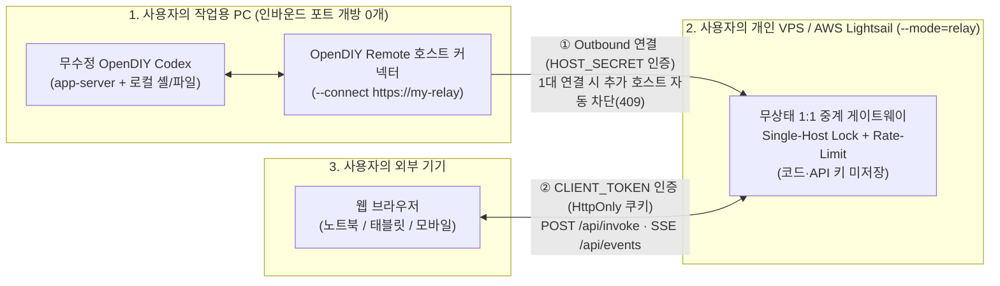

# OpenDIY Remote

웹 브라우저(PC, 태블릿, 모바일)에서 자신의 작업용 PC에 설치된 [OpenDIY Codex](https://github.com/jaeseongs95/opendiy-codex) CLI 및 앱 서버 세션을 안전하게 원격 제어하는 **1:1 셀프호스팅(Self-hosted) 웹 원격 작업 공간**입니다.

- **원본 프로젝트 무수정 연동**: [OpenDIY Codex](https://github.com/jaeseongs95/opendiy-codex)나 [OpenDIY Desktop](https://github.com/jaeseongs95/opendiy-desktop)을 개조하지 않고, 작업용 PC에 설치된 `opendiy-codex` 실행 파일(`codex` / `opendiy-codex-launcher.exe`)과 표준 JSON-RPC 2.0 및 실시간 프로세스 스트림으로 연동합니다.
- **1인 1중계기(1:1 Relay) 보안 설계**: 사용자가 직접 구축한 가벼운 VPS(AWS Lightsail 등)에는 정적 웹 UI와 무상태 중계기(`--mode=relay`)만 띄우고, 작업용 PC에서 아웃바운드 연결(`--connect`)을 맺어 **집/사무실 PC의 인바운드 포트 개방 0개**, **단일 호스트 독점 잠금(Single-Host Lock)**, **호스트/브라우저 비밀키 분리 및 브루트포스 차단**을 보장합니다.
- **OpenDIY Desktop 기반 웹 UI**: 다중 터미널·대화 그리드, 프로젝트별 그룹 관리, 실시간 터미널(`xterm.js`), 구조화 대화 화면, 질문·승인함(Question Inbox), 예약 작업(Cron), 서브에이전트 관리 UI를 브라우저에서 그대로 제공합니다.

[English](README.md) | **한국어**

---

## 아키텍처 개요 (1:1 셀프호스팅 중계 모드 & 직접 실행 모드)

### 1. 1:1 셀프호스팅 중계(Relay) 구조 (외부 접속 권장)



- **중계 서버(VPS / AWS Lightsail `\$5/월` 플랜 등)**: `opendiy-codex`나 프로젝트 코드를 설치할 필요가 없습니다. 오직 `opendiy-remote` 산출물(`dist/`, `server/remote-server.mjs`)만 올려 `--mode=relay`로 실행합니다.
- **작업용 PC**: 실제로 `opendiy-codex`와 소스 코드가 있는 PC에서 `--connect <중계서버주소>`로 실행하면, 중계 서버로 역방향(Outbound) 연결을 맺어 공유기 포트포워딩 없이 외부 브라우저의 명령을 로컬 PC에서 처리합니다.

### 2. 단일 머신 직접(Direct) 구조 (LAN / Tailscale / 원격 개발 서버)
작업용 머신과 웹 서버가 같은 곳에서 돌아갈 때는 별도 중계기 없이 기본 모드(`--mode=direct`)로 바로 실행할 수 있습니다.

---

## 빠른 시작

### 사전 준비
- **Node.js 22 이상** (권장: Node.js 24)
- 작업용 PC에 설치 및 로그인된 **[OpenDIY Codex](https://github.com/jaeseongs95/opendiy-codex)** (또는 공식 Codex CLI)

### 빌드
```bash
git clone https://github.com/jaeseongs95/opendiy-remote.git
cd opendiy-remote
npm ci
npm run build
```

---

### 시나리오 A: VPS(AWS Lightsail 등)를 1:1 중계 전용 서버로 사용할 때

#### 1단계 — 중계 서버(VPS)에서 실행 (`codex` 설치 불필요)
서버에는 빌드된 `dist/` 폴더와 `server/remote-server.mjs`, `package.json`만 있으면 됩니다.
```bash
node server/remote-server.mjs \
  --mode relay \
  --bind 0.0.0.0:3210 \
  --token "브라우저-접속용-비밀토큰" \
  --host-secret "내-PC-연결용-비밀키"
```

#### 2단계 — 내 작업용 PC에서 중계 서버로 연결 (`opendiy-codex`가 설치된 PC)
```bash
node server/remote-server.mjs \
  --connect http://<중계서버-IP-또는-도메인>:3210 \
  --host-secret "내-PC-연결용-비밀키"
```

#### 3단계 — 외부 브라우저에서 접속
브라우저에서 `http://<중계서버-IP-또는-도메인>:3210/?token=브라우저-접속용-비밀토큰`을 열면, 토큰이 즉시 `HttpOnly; SameSite=Strict` 쿠키 및 `sessionStorage`로 설정되고 주소창에서 제거되며 내 작업용 PC의 `opendiy-codex`와 프로젝트 폴더를 제어할 수 있습니다.

---

### 시나리오 B: 한 머신에서 바로 실행할 때 (`direct` 모드)

#### 로컬 루프백 실행 (기본값 `127.0.0.1:3210`)
```bash
npm start
```

#### LAN / Tailscale 외부 접속 허용
```bash
npm start -- --bind 0.0.0.0:3210 --token "my-secret-access-token"
```

---

## CLI 옵션 및 환경 변수

| CLI 옵션 | 환경 변수 | 기본값 | 설명 |
| --- | --- | --- | --- |
| `--mode <direct\|relay>` | `OPENDIY_REMOTE_MODE` | `direct` | `direct`(직접 실행) 또는 `relay`(1:1 무상태 중계 전용 서버) |
| `--connect <url>` | `OPENDIY_REMOTE_RELAY_URL` | (없음) | 작업용 PC에서 중계 서버로 아웃바운드 연결할 주소 |
| `--host-secret <secret>` | `OPENDIY_REMOTE_HOST_SECRET` | `--token` 값 공유 | 중계 서버와 작업용 PC 호스트 간 인증 비밀키 |
| `--bind <host[:port]>` | `OPENDIY_REMOTE_BIND` | `127.0.0.1:3210` | 바인드할 호스트(및 포트) 주소 |
| `--host <host>` | `OPENDIY_REMOTE_HOST` | `127.0.0.1` | 바인드할 호스트 주소 |
| `--port <port>` | `OPENDIY_REMOTE_PORT` | `3210` | HTTP + SSE 리스닝 포트 |
| `--token <secret>` | `OPENDIY_REMOTE_TOKEN` | (없음) | 브라우저 원격 접속 인증용 토큰 (비루프백 바인드 시 필수) |
| `--workspace <dir>` | `OPENDIY_REMOTE_DATA_DIR` | OS 임시/작업 경로 | 레이아웃·프로젝트·세션 메타데이터 저장 디렉터리(절대 경로) |
| - | `OPENDIY_CODEX_BIN` | 자동 탐색 | 사용할 `codex` / `opendiy-codex-launcher` 실행 파일 절대 경로 |
| - | `OPENDIY_REMOTE_DIST` | `./dist` | 서빙할 프런트엔드 빌드 산출물 디렉터리 경로 |

---

## 보안 모델 (Security-First 1:1 Relay)

1. **로컬 PC 인바운드 포트 개방 0개**: 작업용 PC는 외부 포트를 열지 않고 중계기로 아웃바운드 연결(`--connect`)만 유지합니다.
2. **단일 호스트 독점 잠금 (Single-Host Lock)**: 한 중계기에는 오직 소유자의 PC 1대만 연결됩니다. 이미 호스트가 연결된 상태에서 다른 호스트 연결 시도는 `409 Conflict`로 즉시 차단됩니다.
3. **상수 시간 토큰 검증 및 브루트포스 잠금**: 모든 토큰·비밀키는 SHA-256 해시 후 `crypto.timingSafeEqual`로 비교하며, 반복 인증 실패(5회 이상) 시 해당 IP를 자동 잠금(`429 Too Many Requests`)합니다.
4. **무상태(Stateless) 중계**: `--mode=relay` 서버는 사용자의 소스 코드, 프로젝트 상태, OpenAI API 키, `~/.codex` 인증 파일을 디스크에 저장하지 않습니다.
5. **자원 상한 보호**: HTTP 요청 본문 상한(`16 MiB`)과 SSE 클라이언트당 송신 버퍼 상한(`1 MiB`)을 강제합니다.

---

## 개발 및 검증 명령

```bash
# 의존성 설치
npm ci

# 단위 시험 (모델 불변조건, 1:1 릴레이·호스트 커넥터, API·인증·명령 브리지 시험)
npm test

# 프로덕션 프런트엔드 빌드 (TypeScript 타입 검사 + Vite 번들링)
npm run build

# Playwright 브라우저 E2E 시험
npm run test:e2e
```

---

## 라이선스

[MIT License](LICENSE)
