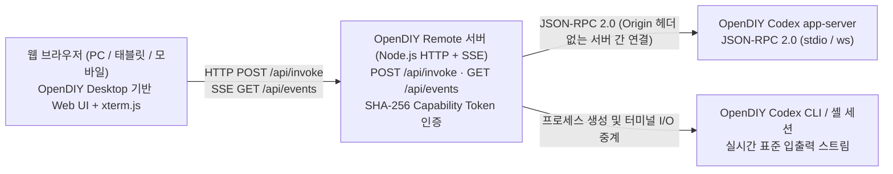

# OpenDIY Remote

웹 브라우저(PC, 태블릿, 모바일)에서 호스트 머신의 [OpenDIY Codex](https://github.com/jaeseongs95/opendiy-codex) CLI 및 앱 서버 세션을 원격으로 제어하는 독립 웹 작업 공간입니다.

- **원본 프로젝트 무수정 연동**: [OpenDIY Codex](https://github.com/jaeseongs95/opendiy-codex)나 [OpenDIY Desktop](https://github.com/jaeseongs95/opendiy-desktop)을 개조하지 않고, 호스트에 설치된 `opendiy-codex` 실행 파일(`codex` / `opendiy-codex-launcher.exe`)과 표준 JSON-RPC 및 프로세스 스트림으로 연동합니다.
- **OpenDIY Desktop 기반 웹 UI**: 다중 터미널·대화 그리드, 프로젝트별 그룹 관리, 실시간 터미널(`xterm.js`), 구조화 대화 화면, 질문·승인함(Question Inbox), 예약 작업(Cron), 서브에이전트 관리 UI를 브라우저에서 그대로 제공합니다.
- **경량 순수 웹 아키텍처**: Tauri·WebView2 데스크톱 런타임 없이 Node.js HTTP/SSE 게이트웨이 서버(`server/remote-server.mjs`)와 브라우저 RPC 브리지(`src/remote-bridge.ts`)만으로 동작합니다.

[English](README.md) | **한국어**

---

## 아키텍처 개요



### 왜 별도의 원격 게이트웨이 서버가 필요한가?
`opendiy-codex`의 `codex app-server` WebSocket 리스너는 보안상 브라우저의 `Origin` 헤더가 포함된 직접 연결을 `403 FORBIDDEN`으로 차단합니다. `OpenDIY Remote` 서버는:
1. 브라우저에 정적 웹 UI(`dist/`)를 서빙하고 `window.__OPENDIY_REMOTE__ = true` 런타임 플래그를 주입합니다.
2. 원격 브라우저 요청을 SHA-256 상수 시간(`timingSafeEqual`) 토큰 검증으로 인증합니다.
3. 백엔드에서 호스트의 `opendiy-codex` `app-server` 및 세션 프로세스와 직접 통신하고, 출력 이벤트를 제한된 크기의 SSE 큐(`GET /api/events`)로 브라우저에 스트리밍합니다.

---

## 빠른 시작

### 1. 사전 준비
- **Node.js 22 이상** (권장: Node.js 24)
- 호스트 머신에 설치 및 로그인된 **[OpenDIY Codex](https://github.com/jaeseongs95/opendiy-codex)** (또는 공식 Codex CLI)

### 2. 설치 및 빌드
```bash
git clone https://github.com/jaeseongs95/opendiy-remote.git
cd opendiy-remote
npm ci
npm run build
```

### 3. 원격 서버 실행

#### 로컬 루프백 실행 (기본값 `127.0.0.1:3210`)
```bash
npm start
```
브라우저에서 `http://127.0.0.1:3210`을 엽니다.

#### 외부 네트워크(LAN / Tailscale / 원격 기기) 접속 허용
루프백(`127.0.0.1`, `localhost`, `::1`)이 아닌 주소로 바인딩할 때는 보안을 위해 `--token` 또는 `OPENDIY_REMOTE_TOKEN` 지정이 **필수**입니다(미지정 시 서버가 시작을 거부합니다).

```bash
npm start -- --bind 0.0.0.0:3210 --token "my-secret-access-token"
```
원격 기기의 브라우저에서 `http://<호스트-IP>:3210/?token=my-secret-access-token`으로 접속하면 토큰이 브라우저 `sessionStorage`에 저장되고 URL 쿼리에서 자동 제거됩니다.

---

## CLI 옵션 및 환경 변수

| CLI 옵션 | 환경 변수 | 기본값 | 설명 |
| --- | --- | --- | --- |
| `--bind <host[:port]>` | `OPENDIY_REMOTE_BIND` | `127.0.0.1:3210` | 바인드할 호스트(및 포트) 주소 |
| `--host <host>` | `OPENDIY_REMOTE_HOST` | `127.0.0.1` | 바인드할 호스트 주소 |
| `--port <port>` | `OPENDIY_REMOTE_PORT` | `3210` | HTTP + SSE 리스닝 포트 |
| `--token <secret>` | `OPENDIY_REMOTE_TOKEN` | (없음) | 원격 접속 인증용 Bearer / `?token=` 비밀 토큰 (외부 바인드 시 필수) |
| `--workspace <dir>` | `OPENDIY_REMOTE_DATA_DIR` | OS 임시/작업 경로 | 레이아웃·프로젝트·세션 메타데이터 저장 디렉터리(절대 경로) |
| - | `OPENDIY_CODEX_BIN` | 자동 탐색 | 사용할 `codex` / `opendiy-codex-launcher` 실행 파일 절대 경로 |
| - | `OPENDIY_REMOTE_DIST` | `./dist` | 서빙할 프런트엔드 빌드 산출물 디렉터리 경로 |

---

## 개발 및 검증 명령

```bash
# 의존성 설치
npm ci

# 단위 시험 (모델 불변조건 및 원격 서버 API·인증·명령 브리지 시험)
npm test

# 프로덕션 프런트엔드 빌드 (TypeScript 타입 검사 + Vite 번들링)
npm run build

# Playwright 브라우저 E2E 시험
npm run test:e2e
```

---

## 보안 및 데이터 격리 원칙

- **Codex 인증·설정 무침해**: 인증 정보, 설정, 대화 이력의 정본은 호스트의 `opendiy-codex`가 소유하며, `opendiy-remote`는 인증 파일을 복제하거나 외부로 전송하지 않습니다.
- **비루프백 무인증 바인드 차단**: 외부 네트워크 인터페이스(`0.0.0.0` 등)에 토큰 없이 바인드하면 즉시 종료 코드 `1`로 시작을 거부합니다.
- **자원 상한 보호**: HTTP 요청 본문 상한(`16 MiB`)과 SSE 클라이언트당 송신 버퍼 상한(`1 MiB`)을 적용하여 느린 원격 클라이언트로 인한 서버 메모리 누적을 방지합니다.

---

## 라이선스

[MIT License](LICENSE)
