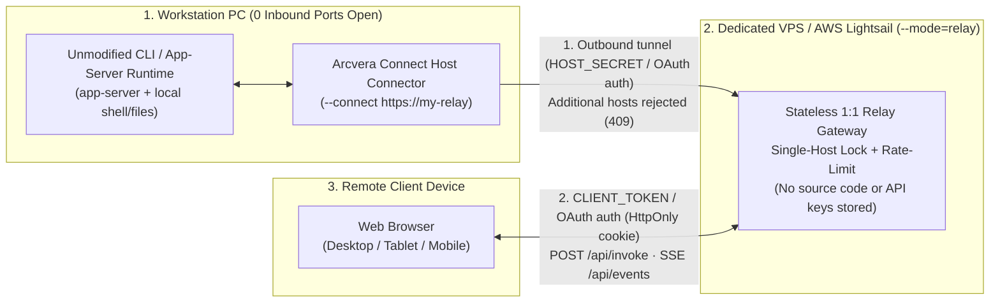

# Arcvera Connect (`opendiy-remote` `v1.2.3`)

**Languages:** **English ([README.md](./README.md))** | **[한국어 (README.ko.md)](./README.ko.md)**

Arcvera Connect (`opendiy-remote`) is a security-first, self-hosted **1:1 remote control web workspace** for running and managing local CLI and app-server agent sessions on a workstation from any modern web browser across desktop, tablet, and mobile devices.

---

## Table of Contents

1. [Overview & Key Features](#overview--key-features)
2. [Architecture Overview](#architecture-overview)
3. [System Requirements & Compatibility](#system-requirements--compatibility)
4. [Quick Start & Deployment](#quick-start--deployment)
5. [CLI Options & Environment Variables](#cli-options--environment-variables)
6. [Security Model](#security-model)
7. [Repository Structure](#repository-structure)
8. [Verification & Testing](#verification--testing)
9. [License](#license)

---

## Overview & Key Features

- **Vendor-Independent Adapter Boundary & Zero Upstream Modification**: Connects to unmodified local CLI and JSON-RPC 2.0 app-server installations (`codex` / `opendiy-codex-launcher.exe` and compatible runtime adapters) using runtime-reported models and capabilities without hardcoding vendor-specific model identifiers.
- **1-Owner-Per-Relay Security Architecture**: Deploys a lightweight, stateless relay (`--mode=relay`) on a dedicated VPS (such as AWS Lightsail) while the workstation connects outbound (`--connect`), keeping **zero inbound ports open on the local workstation**, enforcing a **Single-Host Lock**, separating host and browser secrets, and blocking brute-force attempts.
- **Full Browser Workspace UI**: Organizes sessions by project, renders live `xterm.js` terminals and structured conversation views in a resizable grid, processes pending approvals and structured questions in the Question Inbox, and manages scheduled tasks (Cron), extensions, and subagents remotely.

---

## Architecture Overview

### 1. 1:1 Self-Hosted Relay Mode (Recommended for External Access)



- **Relay Server (VPS / AWS Lightsail, etc.)**: Does not require the agent CLI binary or project files. Deploy only the built `dist/` assets, `server/remote-server.mjs`, and `package.json` running in `--mode=relay`.
- **Workstation PC**: Execute `node server/remote-server.mjs --connect <relay-url>` on the workstation where the CLI runtime and source repositories reside. The connector establishes an outbound tunnel to the relay without router port-forwarding.

### 2. Single-Machine Direct Mode (LAN / Tailscale / Remote Development Host)
When the web server and the CLI runtime execute on the same machine, run in the default `--mode=direct` without a separate relay server.

---

## System Requirements & Compatibility

- **Node.js**: `>= 22.0.0` (Node.js 24 LTS recommended)
- **Supported Runtime Environments**: [OpenDIY Codex](https://github.com/jaeseongs95/opendiy-codex) or compatible JSON-RPC 2.0 / CLI runtimes installed and authenticated on the workstation
- **Supported Relay Operating Systems**: Linux (Ubuntu / Debian `systemd` installer provided), macOS, and Windows

---

## Quick Start & Deployment

### Build from Source
```bash
git clone https://github.com/jaeseongs95/Arcvera-Connect.git
cd Arcvera-Connect
npm ci
npm run build
```

### Scenario A: Dedicated VPS as a 1:1 Relay Server

#### Option 1 — Automated VPS Installer (Ubuntu / Debian)
Execute the following command on a clean Ubuntu or Debian server to verify or install Node.js 22+ via a signed APT keyring, verify the release bundle SHA-256 digest before staged extraction, provision a TLS certificate, register the `systemd` service (`opendiy-remote.service` with `0600` `EnvironmentFile`), and generate access credentials:
```bash
curl -fsSL https://github.com/jaeseongs95/Arcvera-Connect/releases/download/v1.2.3/install-relay.sh | bash
```

#### Option 2 — Manual Relay Execution (No CLI Binary Required on VPS)
Only `dist/`, `server/remote-server.mjs`, and `package.json` are required on the relay server:
```bash
node server/remote-server.mjs \
  --mode relay \
  --bind 0.0.0.0:3210 \
  --token "my-browser-access-token" \
  --host-secret "my-pc-connector-secret"
```

#### Connect the Workstation PC to the Relay
On the workstation where the CLI runtime is installed (when Google OAuth is configured on the relay, `--host-secret` is optional and the connector opens a browser login on first run):
```bash
# Google OAuth mode (recommended when OAuth is configured on the relay):
node server/remote-server.mjs --connect https://<relay-domain>

# Self-signed relay TLS certificate pinning + explicit shared host secret mode:
node server/remote-server.mjs \
  --connect https://<relay-ip-or-domain>:3210 \
  --host-secret "my-pc-connector-secret" \
  --tls-ca ./relay-cert.pem
```

#### Open in a Web Browser
Navigate to `https://<relay-ip-or-domain>:3210/` and submit the browser access token on the login form (`POST /auth/token`). The server sets an `HttpOnly; SameSite=Strict` session cookie without storing the token in `sessionStorage` or URL query strings (Google OAuth callbacks issue an `HttpOnly; SameSite=Lax` session cookie, and legacy `/?token=...` links immediately `302`-redirect to `/` after setting `HttpOnly; SameSite=Strict`).

### Scenario B: Single-Machine Direct Mode (`direct`)

#### Local Loopback (Default `127.0.0.1:3210`)
```bash
npm start
```

#### LAN / Tailscale Access
```bash
npm start -- --bind 0.0.0.0:3210 --token "my-secret-access-token"
```

---

## CLI Options & Environment Variables

| CLI Flag | Environment Variable | Default | Description |
| --- | --- | --- | --- |
| `--mode <direct\|relay>` | `OPENDIY_REMOTE_MODE` | `direct` | Operating mode: `direct` (local execution) or `relay` (stateless 1:1 relay server) |
| `--connect <url>` | `OPENDIY_REMOTE_RELAY_URL` | `(none)` | Outbound relay URL to connect from the workstation PC |
| `--host-secret <secret>` | `OPENDIY_REMOTE_HOST_SECRET` | `--token` value | Shared secret authenticating the workstation connector to the relay |
| `--bind <host[:port]>` | `OPENDIY_REMOTE_BIND` | `127.0.0.1:3210` | Bind host and optional port |
| `--host <host>` | `OPENDIY_REMOTE_HOST` | `127.0.0.1` | Bind host address |
| `--port <port>` | `OPENDIY_REMOTE_PORT` | `3210` | HTTP and SSE listening port |
| `--token <secret>` | `OPENDIY_REMOTE_TOKEN` | `(none)` | Browser authentication token (required for non-loopback binds unless Google OAuth is configured) |
| `--google-client-id <id>` | `OPENDIY_REMOTE_GOOGLE_CLIENT_ID` | `(none)` | Google OAuth 2.0 Client ID for browser and host authentication |
| `--google-client-secret <sec>` | `OPENDIY_REMOTE_GOOGLE_CLIENT_SECRET` | `(none)` | Google OAuth 2.0 Client Secret |
| `--allowed-email <emails>` | `OPENDIY_REMOTE_ALLOWED_EMAIL` | `(none)` | Comma-separated owner Google email address(es) permitted to sign in |
| `--tls-cert <path>` | `OPENDIY_REMOTE_TLS_CERT` | `(none)` | TLS certificate PEM path for native HTTPS serving |
| `--tls-key <path>` | `OPENDIY_REMOTE_TLS_KEY` | `(none)` | TLS private key PEM path for native HTTPS serving |
| `--tls-ca <path>` | `OPENDIY_REMOTE_TLS_CA` | `(none)` | Trusted CA / pinned relay certificate PEM path for outbound `--connect` TLS verification |
| `--auto-update` | `OPENDIY_REMOTE_AUTO_UPDATE` | `false` | Periodically check GitHub Releases and apply SHA-256 verified atomic self-updates |
| `--check-update` / `--update` | `-` | `-` | Check for the latest release or immediately apply an atomic self-update from the CLI |
| `--workspace <dir>` | `OPENDIY_REMOTE_DATA_DIR` | OS temp/work dir | Absolute directory path for persisted layout, project registry, and session metadata |
| `-` | `OPENDIY_CODEX_BIN` | auto-detected | Absolute path to the CLI / launcher executable |
| `-` | `OPENDIY_REMOTE_DIST` | `./dist` | Directory path of built frontend assets to serve |

---

## Security Model

1. **Zero Inbound Workstation Ports**: The workstation initiates an outbound connection (`--connect`) to the relay so local firewall inbound ports remain closed.
2. **Single-Host Lock**: Each relay accepts at most one active workstation tunnel. Additional host registration attempts while a host is connected are rejected with `409 Conflict`.
3. **Constant-Time Secret Verification & Brute-Force Lockout**: Browser tokens and host secrets are hashed with SHA-256 and compared via `crypto.timingSafeEqual`. Repeated authentication failures trigger per-IP rate limiting (`429 Too Many Requests`), and cross-origin browser `POST` invocations are blocked (`403 Forbidden`).
4. **Stateless Relay Isolation**: In `--mode=relay`, the relay server never stores source repositories, workspace state, provider API keys, or local CLI credentials on disk, and restricts proxied RPC methods to `RELAY_COMMAND_ALLOWLIST`.
5. **Filesystem & Resource Boundaries**: Static asset serving and attachment staging enforce `fs.realpathSync` containment checks (blocking symlink escapes), `64 KiB` UTF-8 message caps, `16 MiB` HTTP body limits, and `1 MiB` per-client SSE write buffer caps.

---

## Repository Structure

```text
Arcvera-Connect/
├── server/
│   └── remote-server.mjs
├── src/
│   ├── main.ts
│   ├── remote-bridge.ts
│   ├── model.ts
│   └── model.test.ts
├── scripts/
│   └── install-relay.sh
├── docs/
│   ├── relay-protocol.md
│   └── templates/
│       ├── README_TEMPLATE.md
│       └── RELEASE_NOTES_TEMPLATE.md
├── tests/
│   └── *.spec.ts
├── README.md
├── README.ko.md
├── LICENSE
└── package.json
```

---

## Verification & Testing

```bash
# Install dependencies
npm ci

# Run unit, 1:1 relay/connector, and remote server integration tests
npm test

# Type-check and build the production web bundle
npm run build

# Run Playwright browser E2E suites
npm run test:e2e
```

---

## License

[MIT License](LICENSE)
