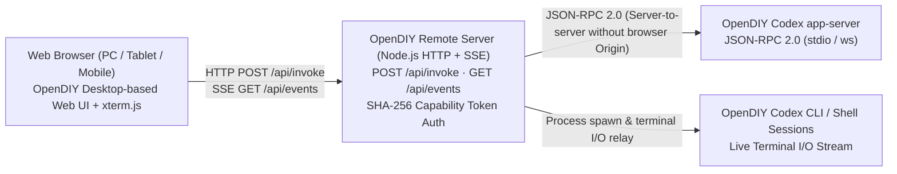

# OpenDIY Remote

A standalone, browser-accessible remote control workspace for running and managing [OpenDIY Codex](https://github.com/jaeseongs95/opendiy-codex) CLI and app-server sessions from any modern web browser (desktop, tablet, or mobile).

- **Zero Modification to Upstream Projects**: Connects to an unmodified [OpenDIY Codex](https://github.com/jaeseongs95/opendiy-codex) installation (`codex` / `opendiy-codex-launcher.exe`) via standard JSON-RPC and process streams, while adopting the multi-session workspace UI of [OpenDIY Desktop](https://github.com/jaeseongs95/opendiy-desktop).
- **Full Workspace UI in the Browser**: Group sessions by project, arrange live `xterm.js` terminals and structured conversation views in a resizable grid, answer approval/question prompts from the Question Inbox, and manage scheduled tasks (Cron) and subagents remotely.
- **Pure Web Architecture**: Runs with a zero-dependency Node.js HTTP + SSE gateway server (`server/remote-server.mjs`) and a browser IPC bridge (`src/remote-bridge.ts`)—no Tauri or WebView2 desktop runtime required.

**English** | [한국어](README.ko.md)

---

## Architecture Overview



### Why a Dedicated Remote Gateway Server?
`opendiy-codex`'s `codex app-server` WebSocket listener rejects browser connections carrying an `Origin` header (`403 FORBIDDEN`) to prevent cross-origin localhost attacks. `OpenDIY Remote` bridges this safely:
1. Serves the built frontend (`dist/`) and injects `window.__OPENDIY_REMOTE__ = true`.
2. Authenticates browser requests using constant-time SHA-256 token verification (`crypto.timingSafeEqual`).
3. Communicates with the host's `opendiy-codex` `app-server` and CLI sessions on the backend, streaming real-time events to browsers over bounded SSE channels (`GET /api/events`).

---

## Quick Start

### 1. Prerequisites
- **Node.js 22+** (Node.js 24 recommended)
- **[OpenDIY Codex](https://github.com/jaeseongs95/opendiy-codex)** (or official Codex CLI) installed and signed in on the host machine

### 2. Install & Build
```bash
git clone https://github.com/jaeseongs95/opendiy-remote.git
cd opendiy-remote
npm ci
npm run build
```

### 3. Start the Remote Server

#### Local Loopback (Default `127.0.0.1:3210`)
```bash
npm start
```
Open `http://127.0.0.1:3210` in your browser.

#### LAN / Tailscale / Remote Device Access
Binding to a non-loopback address (`0.0.0.0` or a LAN IP) **requires** `--token` or `OPENDIY_REMOTE_TOKEN` (the server refuses to start without authentication on non-loopback interfaces):

```bash
npm start -- --bind 0.0.0.0:3210 --token "my-secret-access-token"
```
Open `http://<host-ip>:3210/?token=my-secret-access-token` in your remote browser. The token is stored in `sessionStorage` and automatically stripped from the URL bar.

---

## CLI Options & Environment Variables

| CLI Flag | Environment Variable | Default | Description |
| --- | --- | --- | --- |
| `--bind <host[:port]>` | `OPENDIY_REMOTE_BIND` | `127.0.0.1:3210` | Host (and optional port) to bind |
| `--host <host>` | `OPENDIY_REMOTE_HOST` | `127.0.0.1` | Host address to bind |
| `--port <port>` | `OPENDIY_REMOTE_PORT` | `3210` | HTTP + SSE listening port |
| `--token <secret>` | `OPENDIY_REMOTE_TOKEN` | (none) | Bearer / `?token=` secret for remote authentication (required for non-loopback binds) |
| `--workspace <dir>` | `OPENDIY_REMOTE_DATA_DIR` | OS temp/work dir | Absolute directory path for persisted layout, projects, and session metadata |
| - | `OPENDIY_CODEX_BIN` | auto-detected | Absolute path to the `codex` / `opendiy-codex-launcher` executable |
| - | `OPENDIY_REMOTE_DIST` | `./dist` | Directory path of built frontend assets to serve |

---

## Development & Verification

```bash
# Install dependencies
npm ci

# Run unit & remote server integration tests
npm test

# Type-check and build production web bundle
npm run build

# Run Playwright browser E2E tests
npm run test:e2e
```

---

## Security & Data Isolation

- **Codex Owns Credentials & Config**: Authentication files, configuration, and conversation history remain owned by `opendiy-codex` on the host. `opendiy-remote` never copies or exposes credential files.
- **Fail-Closed Non-Loopback Binding**: Starting the server on a non-loopback address without `--token` / `OPENDIY_REMOTE_TOKEN` exits immediately with code `1`.
- **Bounded Resource Buffers**: Enforces a `16 MiB` HTTP request body limit and a `1 MiB` per-client SSE write buffer cap to prevent slow remote clients from exhausting host memory.

---

## License

[MIT License](LICENSE)
