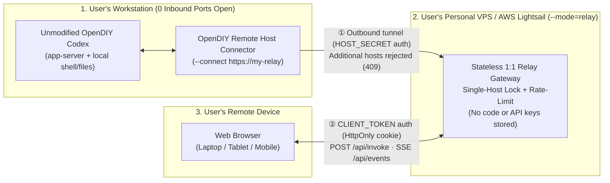

# OpenDIY Remote

A security-first, self-hosted **1:1 remote control web workspace** for running and managing [OpenDIY Codex](https://github.com/jaeseongs95/opendiy-codex) CLI and app-server sessions on your local workstation from any modern web browser (desktop, tablet, or mobile).

- **Zero Modification to Upstream Projects**: Connects to an unmodified [OpenDIY Codex](https://github.com/jaeseongs95/opendiy-codex) installation (`codex` / `opendiy-codex-launcher.exe`) via standard JSON-RPC 2.0 and live process streams, while providing the multi-session workspace UI of [OpenDIY Desktop](https://github.com/jaeseongs95/opendiy-desktop).
- **1-Owner-Per-Relay Security Architecture**: Deploy a lightweight, stateless relay (`--mode=relay`) on your own VPS (e.g., AWS Lightsail) and connect your workstation outbound (`--connect`). Keeps **zero inbound ports open on your local PC**, enforces a **Single-Host Lock**, separates host/browser secrets, and blocks brute-force attempts.
- **Full Workspace UI in the Browser**: Group sessions by project, arrange live `xterm.js` terminals and structured conversation views in a resizable grid, answer approval/question prompts from the Question Inbox, and manage scheduled tasks (Cron) and subagents remotely.

**English** | [한국어](README.ko.md)

---

## Architecture Overview (1:1 Self-Hosted Relay & Direct Mode)

### 1. 1:1 Self-Hosted Relay Mode (Recommended for External Access)



- **Relay Server (VPS / AWS Lightsail `\$5/mo` plan, etc.)**: Does **not** require `opendiy-codex` or your project files. Only deploy the built `dist/` assets and `server/remote-server.mjs` running in `--mode=relay`.
- **Workstation PC**: Run `node server/remote-server.mjs --connect <relay-url>` on the machine where `opendiy-codex` and your source code live. It establishes an outbound connection to your relay so no router port-forwarding is needed.

### 2. Single-Machine Direct Mode (LAN / Tailscale / Remote Dev Host)
When the web server and `opendiy-codex` run on the same machine, run in the default `--mode=direct` without a separate relay.

---

## Quick Start

### Prerequisites
- **Node.js 22+** (Node.js 24 recommended)
- **[OpenDIY Codex](https://github.com/jaeseongs95/opendiy-codex)** (or official Codex CLI) installed and signed in on your workstation

### Build
```bash
git clone https://github.com/jaeseongs95/opendiy-remote.git
cd opendiy-remote
npm ci
npm run build
```

---

### Scenario A: Using a VPS (e.g., AWS Lightsail) as a 1:1 Dedicated Relay

#### Option 1 — One-Click VPS Install (Ubuntu / Debian)
Run a single command on your fresh Ubuntu/Debian VPS to install Node.js 22+, download the pre-built release bundle, register the `systemd` service (`opendiy-remote.service`), and generate random access credentials automatically:
```bash
curl -fsSL https://github.com/jaeseongs95/opendiy-remote/releases/download/v1.2.1/install-relay.sh | bash
```

#### Option 2 — Manual Relay Startup (No `codex` binary required)
Only `dist/`, `server/remote-server.mjs`, and `package.json` are needed on the VPS:
```bash
node server/remote-server.mjs \
  --mode relay \
  --bind 0.0.0.0:3210 \
  --token "my-browser-access-token" \
  --host-secret "my-pc-connector-secret"
```

#### Step 2 — Connect Your Workstation PC to the Relay
On your workstation where `opendiy-codex` is installed (when Google OAuth is enabled on the relay, `--host-secret` is optional and the connector will automatically open your browser for Google OAuth sign-in and cache the token locally):
```bash
# Google OAuth mode (recommended — opens browser login automatically on first run):
node server/remote-server.mjs --connect https://<relay-domain>

# Or with explicit host secret:
node server/remote-server.mjs \
  --connect http://<relay-ip-or-domain>:3210 \
  --host-secret "my-pc-connector-secret"
```

#### Step 3 — Open in Any Browser
Visit `http://<relay-ip-or-domain>:3210/?token=my-browser-access-token`. The token is automatically stored in an `HttpOnly; SameSite=Strict` cookie and `sessionStorage` and stripped from the URL bar.

---

### Scenario B: Running Directly on One Machine (`direct` mode)

#### Local Loopback (Default `127.0.0.1:3210`)
```bash
npm start
```

#### LAN / Tailscale Access
```bash
npm start -- --bind 0.0.0.0:3210 --token "my-secret-access-token"
```

---

## CLI Options & Environment Variables

| CLI Flag | Environment Variable | Default | Description |
| --- | --- | --- | --- |
| `--mode <direct\|relay>` | `OPENDIY_REMOTE_MODE` | `direct` | `direct` (local execution) or `relay` (stateless 1:1 relay server) |
| `--connect <url>` | `OPENDIY_REMOTE_RELAY_URL` | (none) | Outbound relay URL to connect from the workstation PC |
| `--host-secret <secret>` | `OPENDIY_REMOTE_HOST_SECRET` | defaults to `--token` | Shared secret authenticating the workstation connector to the relay |
| `--bind <host[:port]>` | `OPENDIY_REMOTE_BIND` | `127.0.0.1:3210` | Host (and optional port) to bind |
| `--host <host>` | `OPENDIY_REMOTE_HOST` | `127.0.0.1` | Host address to bind |
| `--port <port>` | `OPENDIY_REMOTE_PORT` | `3210` | HTTP + SSE listening port |
| `--token <secret>` | `OPENDIY_REMOTE_TOKEN` | (none) | Browser authentication token (required for non-loopback binds unless Google OAuth is enabled) |
| `--google-client-id <id>` | `OPENDIY_REMOTE_GOOGLE_CLIENT_ID` | (none) | Google OAuth 2.0 Client ID for browser login |
| `--google-client-secret <sec>` | `OPENDIY_REMOTE_GOOGLE_CLIENT_SECRET` | (none) | Google OAuth 2.0 Client Secret |
| `--allowed-email <emails>` | `OPENDIY_REMOTE_ALLOWED_EMAIL` | (none) | Comma-separated owner Google email(s) allowed to sign in |
| `--tls-cert <path>` | `OPENDIY_REMOTE_TLS_CERT` | (none) | TLS certificate PEM path for native HTTPS server |
| `--tls-key <path>` | `OPENDIY_REMOTE_TLS_KEY` | (none) | TLS private key PEM path for native HTTPS server |
| `--auto-update` | `OPENDIY_REMOTE_AUTO_UPDATE` | `false` | Periodically check GitHub Releases and self-update with SHA-256 verification |
| `--check-update` / `--update` | - | - | Check for the latest release or immediately apply self-update from CLI |
| `--workspace <dir>` | `OPENDIY_REMOTE_DATA_DIR` | OS temp/work dir | Absolute directory path for persisted layout, projects, and session metadata |
| - | `OPENDIY_CODEX_BIN` | auto-detected | Absolute path to the `codex` / `opendiy-codex-launcher` executable |
| - | `OPENDIY_REMOTE_DIST` | `./dist` | Directory path of built frontend assets to serve |

---

## Security Model (Security-First 1:1 Relay)

1. **Zero Inbound Ports on Workstation**: Your workstation initiates an outbound connection (`--connect`) to the relay, keeping local firewall inbound ports closed.
2. **Single-Host Lock**: Each relay instance accepts only one active workstation connection. Any second host registration attempt while a host is connected is rejected with `409 Conflict`.
3. **Constant-Time Token Verification & Brute-Force Lockout**: Tokens and host secrets are hashed with SHA-256 and compared via `crypto.timingSafeEqual`. Repeated authentication failures (5+ attempts) trigger an IP lockout (`429 Too Many Requests`).
4. **Stateless Relay**: In `--mode=relay`, the server never stores your source code, workspace state, OpenAI API keys, or `~/.codex` credentials on disk.
5. **Bounded Resource Buffers**: Enforces a `16 MiB` HTTP request body limit and a `1 MiB` per-client SSE write buffer cap.

---

## Development & Verification

```bash
# Install dependencies
npm ci

# Run unit, 1:1 relay/connector, and remote server integration tests
npm test

# Type-check and build production web bundle
npm run build

# Run Playwright browser E2E tests
npm run test:e2e
```

---

## License

[MIT License](LICENSE)
